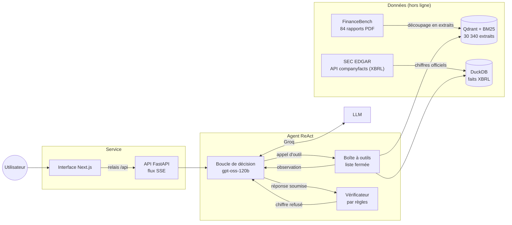
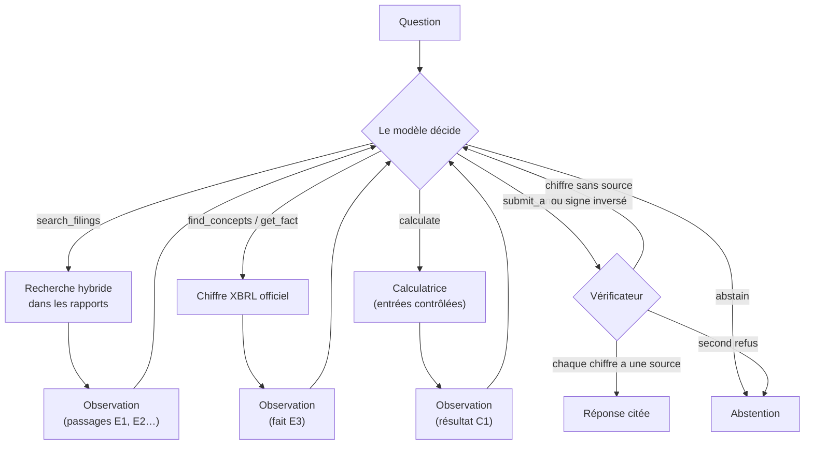
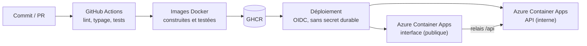

# Architecture

Ce document décrit comment une question devient une réponse dont chaque chiffre a une source :
les données, l'agent, la vérification, le service et le déploiement.

## Vue d'ensemble

## La boucle de l'agent

À chaque tour, le modèle choisit **un outil et ses arguments**, lit le résultat, puis décide de
la suite. Le code ne fixe ni l'ordre ni le nombre des étapes, seulement un plafond.

Exemple réel, « De combien les dépenses d'investissement de 3M ont-elles évolué entre 2017 et
2018 ? » : `find_concepts` → `get_fact` (2017, E1) → `get_fact` (2018, E2) → `calculate`
(C1 = 14,86) → `submit_answer` → vérification réussie. Sur une autre question, l'agent enchaîne
d'autres outils, dans un autre ordre.

**Garde-fous :**

| Garde-fou | Rôle |
|---|---|
| Liste fermée d'outils | Le nom choisi par le modèle ne peut pas atteindre une autre fonction |
| Calculatrice par arbre syntaxique | L'expression est analysée, jamais exécutée ; nombres en clair interdits |
| Entrées de calcul contrôlées | Chaque valeur doit figurer dans la preuve citée (à une échelle près) |
| Vérificateur par règles | Chaque nombre de la réponse vient d'une preuve ou d'un calcul, avec le bon signe |
| Budget de 12 tours | Au dernier tour, seuls `submit_answer` et `abstain` sont proposés |

Le vérificateur garantit la **traçabilité** des chiffres, pas l'exactitude du raisonnement : une
formule mal choisie donne un chiffre traçable mais faux. C'est ce que mesure l'évaluation.

## Agent ReAct et workflow à étapes fixes

Le dépôt contient deux architectures, comparées dans l'évaluation.

| | Workflow (`agent/graph.py`) | Agent ReAct (`agent/react.py`) |
|---|---|---|
| Qui décide de l'enchaînement ? | Le code | Le modèle |
| Parcours | Toujours planifier → collecter → juger → rédiger → vérifier | Variable selon la question |
| Le modèle voit les résultats des outils ? | Non, la collecte est faite d'un bloc | Oui, après chaque appel |
| Peut changer de stratégie ? | Une boucle limitée (nouvelles requêtes) | Oui, à chaque tour |
| Coût en tokens | Plus faible | Plus élevé |

Le workflow est un *workflow agentique* : le modèle agit à l'intérieur d'étapes fixes. L'agent
ReAct est un *RAG agentique* au sens strict : le modèle pilote sa propre recherche. La variante
`workflow_120b` utilise le même modèle que l'agent à toutes les étapes, pour isoler l'effet de
l'architecture de celui de la taille du modèle.

## Données

- **Rapports** : les 84 PDF cités par les questions publiques de FinanceBench, découpés en
  30 340 extraits (une page au plus, avec un en-tête de contexte). Index vectoriel Qdrant
  (`bge-small-en-v1.5`, sur CPU) et index lexical BM25, fusionnés par RRF.
- **Chiffres officiels** : environ 896 000 faits XBRL de 32 entreprises, issus de l'API
  companyfacts de SEC EDGAR, dans DuckDB en lecture seule. L'exercice de chaque fait est
  recalculé à partir de sa date de fin de période.
- **Limite connue** : le corpus de rapports est figé (celui de FinanceBench). Seuls les chiffres
  XBRL viennent d'EDGAR ; il n'y a pas d'ingestion automatique des nouveaux rapports.

## Service et déploiement

- L'**API n'est pas exposée** : seule l'interface est publique, et elle relaie une liste fermée
  de routes vers l'API interne.
- L'image de l'API embarque un **snapshot versionné** des index et de la base de faits, vérifié
  par son empreinte : aucun appel à EDGAR n'est nécessaire au démarrage.
- **Protection du quota gratuit** : limiteur de débit (tokens par minute), cache des appels LLM,
  et limite de questions par visiteur et par heure.
- Les applications s'arrêtent sans visiteur (`minReplicas: 0`) : la première requête après une
  pause attend le démarrage du conteneur.

Le guide pas à pas est dans [deploiement.md](deploiement.md).

## Où trouver quoi

| Élément | Fichier |
|---|---|
| Boucle ReAct | [`agent/react.py`](../backend/src/ledger_agent/agent/react.py) |
| Outils exposés au modèle | [`agent/toolbox.py`](../backend/src/ledger_agent/agent/toolbox.py) |
| Vérificateur de chiffres | [`agent/verify.py`](../backend/src/ledger_agent/agent/verify.py) |
| Workflow à étapes fixes | [`agent/graph.py`](../backend/src/ledger_agent/agent/graph.py), [`agent/nodes.py`](../backend/src/ledger_agent/agent/nodes.py) |
| Calculatrice | [`tools/calculator.py`](../backend/src/ledger_agent/tools/calculator.py) |
| Faits XBRL | [`tools/financial_facts.py`](../backend/src/ledger_agent/tools/financial_facts.py) |
| Recherche dans les rapports | [`tools/search_filings.py`](../backend/src/ledger_agent/tools/search_filings.py), [`retrieval/`](../backend/src/ledger_agent/retrieval) |
| Ingestion | [`ingestion/`](../backend/src/ledger_agent/ingestion) |
| Clients LLM, cache, débit | [`llm/`](../backend/src/ledger_agent/llm), [`common/rate_limit.py`](../backend/src/ledger_agent/common/rate_limit.py) |
| API | [`api/main.py`](../backend/src/ledger_agent/api/main.py), [`api/service.py`](../backend/src/ledger_agent/api/service.py) |
| Interface | [`frontend/app/page.tsx`](../frontend/app/page.tsx), [`frontend/components/`](../frontend/components) |
| Évaluation | [`evaluation/`](../backend/src/ledger_agent/evaluation), [`evaluation/configs/`](../evaluation/configs) |
| Référence RAG classique | [`baselines/naive_rag.py`](../backend/src/ledger_agent/baselines/naive_rag.py) |
| Infrastructure | [`infra/main.bicep`](../infra/main.bicep), [`.github/workflows/`](../.github/workflows) |
